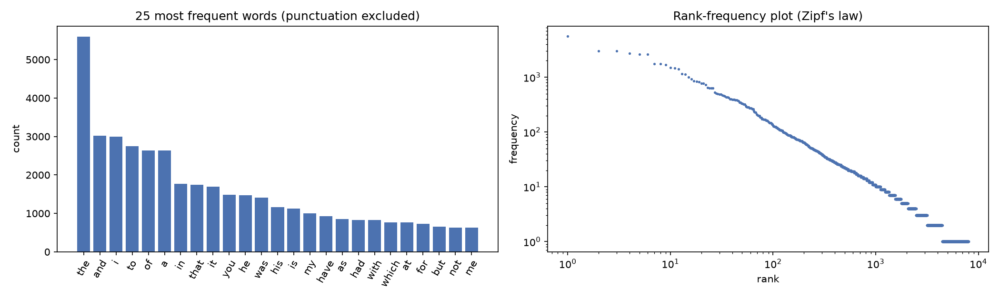
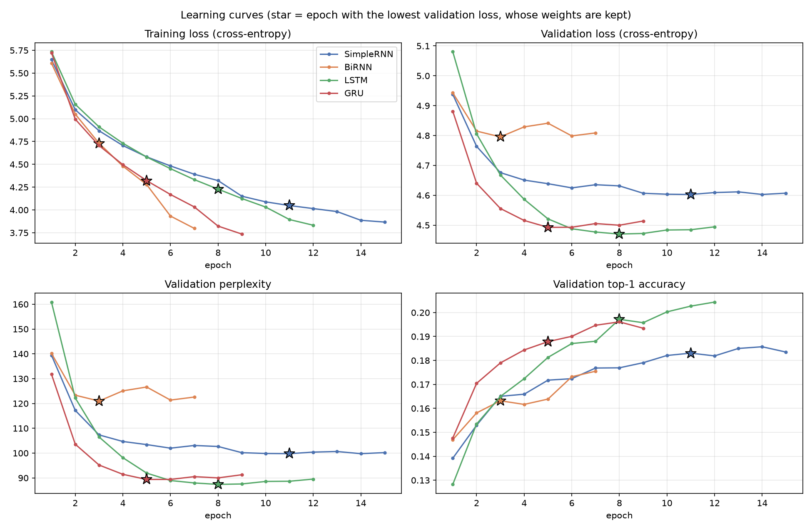
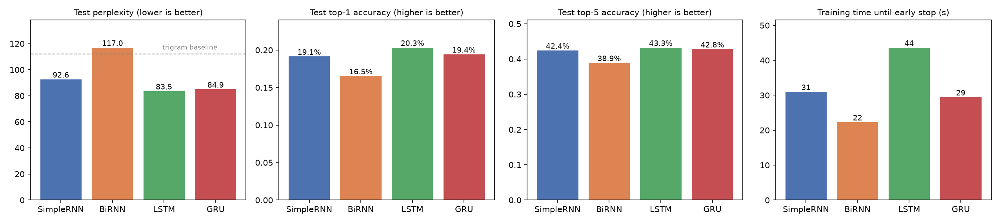
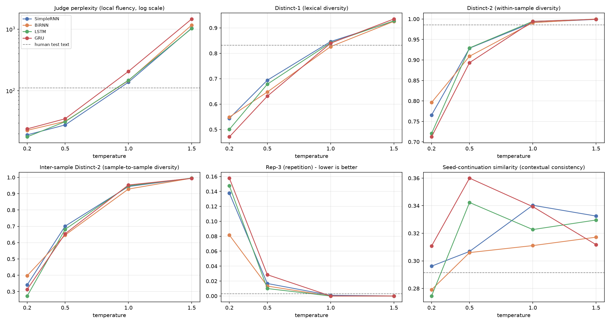
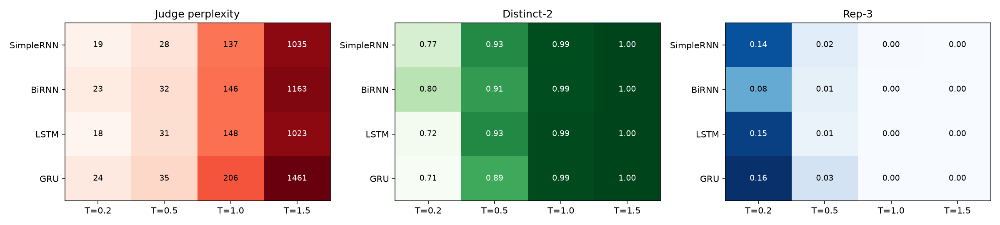

# Autoregressive Text Generation with Simple RNN, Bidirectional RNN, LSTM and GRU

**Foundations of Generative AI (ICT4403), Assignment 2**

This project builds a word-level next-word prediction and text-generation system on *The Adventures of Sherlock Holmes*. It compares four recurrent architectures (Simple RNN, Bidirectional RNN, LSTM, GRU), trained under identical conditions, on predictive quality, generated-text quality and sensitivity to the sampling temperature.

## Contents
1. [Problem statement and objective](#1-problem-statement-and-objective)
2. [Dataset](#2-dataset)
3. [Preprocessing and sequence construction](#3-preprocessing-and-inputtarget-sequence-construction)
4. [Models](#4-models)
5. [How to run](#5-how-to-run)
6. [Results](#6-results)
7. [Model comparison and evaluation](#7-model-comparison-and-evaluation)
8. [Sampling-temperature analysis](#8-sampling-temperature-analysis)
9. [Conclusion](#9-conclusion)
10. [Repository structure](#10-repository-structure)

---

## 1. Problem statement and objective

An **autoregressive language model** factorises the probability of a text as $P(w_1,\dots,w_n)=\prod_t P(w_t \mid w_{<t})$. It generates text by repeatedly predicting a distribution over the next word, sampling a word and feeding it back as input.

**Objective.** Select a text dataset and build such a system with four recurrent architectures: **Simple RNN, Bidirectional RNN, LSTM and GRU**. Train all of them under comparable conditions to predict the next word and generate text from seed sequences. Then:

1. Describe and preprocess the dataset and construct the input–target sequences (Task i).
2. Compare the models quantitatively (loss, perplexity, accuracy, training time) and qualitatively (coherence, diversity, contextual consistency, repetition) (Task ii).
3. Generate text from the same seeds at several sampling temperatures, analyse how temperature affects the output, and justify which model is most effective (Task iii).

## 2. Dataset

| | |
|---|---|
| **Name** | *The Adventures of Sherlock Holmes*, Arthur Conan Doyle (1892) |
| **Source** | Project Gutenberg eBook #1661: <https://www.gutenberg.org/ebooks/1661> |
| **File used** | Plain text UTF-8: <https://www.gutenberg.org/cache/epub/1661/pg1661.txt> (copy in [`data/pg1661.txt`](data/pg1661.txt)) |
| **Licence** | Public domain in the USA (Project Gutenberg licence) |

**Characteristics** (after removing the Gutenberg header/footer, table of contents and story headings):

| Characteristic | Value |
|---|---|
| Stories | 12 short stories, single author, consistent first-person narrator (Dr Watson) |
| Characters / paragraphs / sentences | 561,229 / 2,527 / ≈ 6,805 |
| Paragraphs containing dialogue | 90.7 % |
| Words (raw) / distinct words | 105,139 / 7,930 |
| Mean / median words per sentence | 15.45 / 12 |
| Tokens after tokenisation (words + punctuation) | 120,028 (14,751 punctuation) |
| Type-token ratio | 0.0759 |
| Hapax legomena (words occurring once) | 3,553 (44.4 % of word types) |
| Vocabulary used by the models | 3,918 tokens (training-split words with frequency ≥ 2, plus `<pad>`, `<unk>`) |

The word-frequency distribution follows Zipf's law, and almost half of all word types occur only once, so rare words are the main difficulty for a word-level model.



## 3. Preprocessing and input–target sequence construction

1. **Cleaning.** Strip the Project Gutenberg boilerplate, the title page, the table of contents and story/section headings.
2. **Normalisation.** Lower-case the text; map curly quotes and apostrophes to ASCII; replace em-dashes, hyphens and italics underscores with spaces; remove the period from *Mr., Mrs., Dr., St., Messrs.* so it is not mistaken for a sentence end.
3. **Tokenisation.** Words (keeping contractions and possessives such as `don't` and `holmes's`), numbers, and the punctuation marks `. , ! ? ; :` as separate tokens. Keeping punctuation lets the models learn sentence and clause boundaries. Quotation marks and brackets are dropped.
4. **Split.** Contiguous 80 / 10 / 10 split of the token stream: 96,022 train / 12,002 validation / 12,004 test tokens. A contiguous split prevents overlapping windows from leaking training text into evaluation; the test set is mostly the final story.
5. **Vocabulary.** Built from the training split only (frequency ≥ 2 → 3,918 tokens). All other words become `<unk>`: 3.5 % of training tokens and 6–7 % of validation/test tokens.
6. **Input–target pairs (many-to-one).** A 15-token window slides with stride 1. The window is the input and the following token is the target: $(w_{t-15},\dots,w_{t-1}) \rightarrow w_t$. Windows whose target is `<unk>` are dropped, leaving **92,634 / 11,259 / 11,116** train / validation / test sequences.

```
to sherlock holmes she is always the woman . i have seldom heard him mention   ->  her
sherlock holmes she is always the woman . i have seldom heard him mention her  ->  under
```

## 4. Models

All models share one template and differ **only** in the recurrent encoder:

`Embedding(3918, 128) → Dropout(0.3) → 2-layer recurrent encoder (256 units) → final hidden state → Dropout(0.3) → Linear → softmax over 3,918 tokens`

| Model | Encoder | Idea | Parameters |
|---|---|---|---:|
| **Simple RNN** | `nn.RNN` (tanh) | Elman recurrence $h_t=\tanh(W_x x_t + W_h h_{t-1} + b)$; simple and fast but prone to vanishing gradients | 1,738,830 |
| **Bidirectional RNN** | `nn.RNN`, `bidirectional=True` | A second RNN reads the context right-to-left; final forward and backward states are concatenated (512-d). The target lies after the window, so there is no look-ahead leakage and generation stays autoregressive | 3,103,310 |
| **LSTM** | `nn.LSTM` | Input, forget and output gates plus an additive cell state, giving long-range memory and stable gradients | 2,430,030 |
| **GRU** | `nn.GRU` | Update and reset gates with a single state; a lighter gated alternative to the LSTM | 2,199,630 |

**Identical training conditions:** cross-entropy loss; Adam (lr 1e-3); batch size 128; gradient-norm clipping at 1.0; `ReduceLROnPlateau` (×0.5, patience 1); early stopping on validation loss (patience 4, at most 30 epochs) with the best weights restored; the same seed (42), data order and hardware (NVIDIA RTX 4060 Laptop GPU, PyTorch 2.11 with cuDNN).

**Generation:** the seed is tokenised and the last 15 tokens are fed to the model. The next token is sampled from $\text{softmax}(z/T)$ (never `<pad>`/`<unk>`), appended, and the window slides on; 50 tokens are generated per sample.

## 5. How to run

**Requirements:** Python 3.10+ (tested on 3.12). An NVIDIA GPU is recommended but optional; the notebook falls back to the CPU automatically, where training is considerably slower.

```bash
git clone https://github.com/VermaAditya18/GENAI.git
cd GENAI
python -m venv .venv
# Windows: .venv\Scripts\activate      Linux/macOS: source .venv/bin/activate
pip install torch --index-url https://download.pytorch.org/whl/cu128   # GPU build (or simply: pip install torch)
pip install -r requirements.txt

# run everything (training, evaluation, generation, plots) and save the executed notebook
jupyter nbconvert --to notebook --execute --inplace Text_Generation_RNN_BiRNN_LSTM_GRU.ipynb
# or open it interactively
jupyter notebook Text_Generation_RNN_BiRNN_LSTM_GRU.ipynb
```

Dependencies (see [`requirements.txt`](requirements.txt)): `torch`, `numpy`, `pandas`, `matplotlib`, `jupyter`. The dataset is included in `data/`; it is downloaded automatically if missing. A full run takes about 3–4 minutes on an RTX 4060 laptop GPU. All metrics are exactly reproducible (fixed seeds, deterministic cuDNN); only the wall-clock training times vary slightly.

## 6. Results

### 6.1 Quantitative results (held-out test split, best-validation weights)

| Model | Params | Epochs run (best) | Train time (s) | Median s / epoch | Val PPL | Test loss | **Test PPL** | **Top-1 acc** | Top-5 acc |
|---|---:|---:|---:|---:|---:|---:|---:|---:|---:|
| SimpleRNN | 1,738,830 | 15 (11) | 31.0 | 2.1 | 99.77 | 4.5286 | 92.63 | 19.14 % | 42.43 % |
| BiRNN | 3,103,310 | 7 (3) | 22.3 | 3.2 | 120.98 | 4.7618 | 116.96 | 16.53 % | 38.92 % |
| **LSTM** | 2,430,030 | 12 (8) | 43.6 | 3.7 | 87.38 | 4.4253 | **83.54** | **20.33 %** | 43.25 % |
| GRU | 2,199,630 | 9 (5) | 29.4 | 3.1 | 89.37 | 4.4420 | 84.94 | 19.42 % | 42.79 % |
| Interpolated trigram (baseline) | – | – | – | – | – | 4.7197 | 112.13 | – | – |
| Unigram (baseline) | – | – | – | – | – | 5.7289 | 307.63 | 6.94 % | 22.27 % |





**Statistical check.** Paired bootstrap over the 11,116 test positions (2,000 resamples):

| Comparison | Mean Δ loss (nats) | 95 % CI | P(first better) |
|---|---:|---:|---:|
| LSTM vs GRU | -0.0167 | [-0.0326, -0.0013] | 98.4 % |
| LSTM vs SimpleRNN | -0.1033 | [-0.1214, -0.0854] | 100.0 % |
| LSTM vs BiRNN | -0.3366 | [-0.3573, -0.3167] | 100.0 % |
| GRU vs SimpleRNN | -0.0867 | [-0.1048, -0.0690] | 100.0 % |
| GRU vs BiRNN | -0.3199 | [-0.3390, -0.3013] | 100.0 % |
| SimpleRNN vs BiRNN | -0.2332 | [-0.2528, -0.2138] | 100.0 % |

### 6.2 Generated text

Seeds used for every model and temperature:

1. *To Sherlock Holmes she is always the woman. I have seldom heard him mention her under* (opening line of the book, i.e. from the training data)
2. *It was a cold morning in the early spring, and Holmes was sitting in his chair by the fire*
3. *The door opened and a tall man entered the room. He was dressed in a long dark coat*
4. *You will excuse me, Watson, said Holmes, but I have a small problem which*
5. *The lady sat down and began to tell us the strange story of her father, who had*

**All four models, seed 4, T = 0.5** (sample 1):

> *You will excuse me, Watson, said Holmes, but I have a small problem which* …

| Model | Continuation (50 tokens) |
|---|---|
| SimpleRNN | …he had been in the same room. I have been senseless to me, and I have been to be a policeman and to the police, but you are to go. I have seen it, and I have been, with the same intention of the |
| BiRNN | …is a little, and I should be able to the floor. I have a wild that he would be a little more of the ground. I should be the address. I have not the pleasure of the time. But I think that I had no |
| LSTM | …I found the dead hand. I must call you, and I should be hard to follow. I am afraid to call at the morning. There is no one, and, as I had not been seen myself, and I have seen him to my |
| GRU | …I had done. My dear fellow, said he, the salesman is a very serious man, and I shall have been to you. I have been able to my friend and used in the morning. I have been a very busy and looking in the |

**LSTM, seed 3, at each temperature** (same random stream):

> *The door opened and a tall man entered the room. He was dressed in a long dark coat* …

| T | Continuation (50 tokens) |
|---|---|
| 0.2 | …and the other of the gale of the window, and I have a little one of the matter. I have no doubt that I should be able to be a good. I have no doubt that I have been able to be a little, and |
| 0.5 | …and by the door of the grey keeper with the daughter of the house. It is a very affair, and that part of the morning, I am afraid to you that I had no doubt to see anything of the door. You have been the |
| 1.0 | …and by the chair of lee the whole window, or excellent in a hour of silk into the affair, which was part in which we were tied to! She said that he had remained under their wash. What Holmes has time, too, if |
| 1.5 | …remained by the chair when we exceptional actionable with turn or excellent firm. And why, pressing up. Helen story steps part shot enough for terribly outlined,! Wet full once suggested upon his pool with wash an answered Holmes door softly, too cellar if |

All 800 samples and their metrics are in [`results/generation_samples_and_metrics.csv`](results/generation_samples_and_metrics.csv); a readable selection is in [`results/generated_samples.md`](results/generated_samples.md).

### 6.3 Generation metrics (averaged over 5 seeds × 10 samples × 50 tokens)

Judge PPL = perplexity of the generated text under an independent trigram LM trained on the training split (local fluency). Distinct-n = unique n-grams / total n-grams. Rep-3 = share of repeated word trigrams. Seed–continuation similarity = cosine similarity of mean PPMI-SVD word vectors (contextual consistency). The last row gives the same metrics for real 50-token passages of the test text.

| Model | T | Judge PPL ↓ | Distinct-1 ↑ | Distinct-2 ↑ | Inter-sample Distinct-2 ↑ | Rep-3 ↓ | Seed–continuation sim. |
|---|---:|---:|---:|---:|---:|---:|---:|
| SimpleRNN | 0.2 | 19.2 | 0.544 | 0.766 | 0.341 | 0.138 | 0.296 |
| SimpleRNN | 0.5 | 27.8 | 0.694 | 0.929 | 0.701 | 0.017 | 0.307 |
| SimpleRNN | 1.0 | 137.4 | 0.846 | 0.992 | 0.944 | 0.001 | 0.340 |
| SimpleRNN | 1.5 | 1035.2 | 0.926 | 0.999 | 0.995 | 0.000 | 0.332 |
| BiRNN | 0.2 | 22.7 | 0.549 | 0.796 | 0.397 | 0.082 | 0.279 |
| BiRNN | 0.5 | 31.7 | 0.648 | 0.909 | 0.646 | 0.013 | 0.306 |
| BiRNN | 1.0 | 145.8 | 0.826 | 0.991 | 0.928 | 0.000 | 0.311 |
| BiRNN | 1.5 | 1162.9 | 0.926 | 1.000 | 0.995 | 0.000 | 0.317 |
| LSTM | 0.2 | 17.8 | 0.501 | 0.720 | 0.273 | 0.147 | 0.275 |
| LSTM | 0.5 | 31.4 | 0.678 | 0.929 | 0.681 | 0.010 | 0.342 |
| LSTM | 1.0 | 147.9 | 0.842 | 0.994 | 0.948 | 0.000 | 0.323 |
| LSTM | 1.5 | 1022.7 | 0.928 | 0.999 | 0.995 | 0.000 | 0.330 |
| GRU | 0.2 | 24.0 | 0.471 | 0.712 | 0.313 | 0.158 | 0.311 |
| GRU | 0.5 | 35.0 | 0.631 | 0.893 | 0.655 | 0.028 | 0.360 |
| GRU | 1.0 | 205.8 | 0.840 | 0.994 | 0.953 | 0.000 | 0.339 |
| GRU | 1.5 | 1461.1 | 0.935 | 0.999 | 0.994 | 0.000 | 0.312 |
| *Human test text* | – | 110.6 | 0.832 | 0.985 | – | 0.003 | 0.291 |





## 7. Model comparison and evaluation

### 7.1 Quantitative comparison

* **LSTM is the best next-word predictor** on every measure: test perplexity **83.54**, top-1 accuracy **20.33 %** and top-5 accuracy **43.25 %**. **GRU** is a close second (84.94 / 19.42 % / 42.79 %). The paired bootstrap shows the LSTM–GRU gap is small but consistent: Δloss = -0.0167 nats, 95 % CI [-0.0326, -0.0013], and LSTM is better in 98.4 % of resamples.
* **Gating matters.** Both gated models clearly beat the Simple RNN (test perplexity 92.63). The loss differences are -0.103 and -0.087 nats, and neither confidence interval contains 0. The LSTM's additive cell state and the GRU's update gate let gradients flow across the whole 15-token window. The tanh RNN suffers from vanishing gradients and relies mostly on the last few words, and its validation loss plateaus at about 4.60 from epoch 9 onwards even after the learning rate is halved.
* **The Bidirectional RNN is the weakest model.** Its test perplexity of 116.96 is worse than the Simple RNN and even slightly worse than the count-based trigram baseline (112.13). It reaches its best validation loss at epoch 3 and then overfits fastest: by epoch 7 the training loss has fallen to 3.80 while the validation loss is 4.81. There are two reasons. (1) The target word lies *after* the window, so the backward pass adds no future information. Its final state summarises the context read right-to-left and therefore ends on the *oldest* word, which is the least useful one for predicting the next word. (2) It doubles the recurrent state and the input of the output layer (512 → 3,918), giving the most parameters (3.10 M) on a corpus of only 92,634 training sequences. Bidirectionality helps when the whole sequence is visible (tagging, classification), not for left-to-right generation.
* **Convergence.** GRU converges fastest: it has the lowest validation loss in epochs 1–5 and its best epoch is 5. LSTM starts slowest (epoch-1 validation perplexity 160.9) but keeps improving until epoch 8 and finishes lowest.
* **Training time.** Median time per epoch: Simple RNN 2.1 s, GRU 3.1 s, LSTM 3.7 s, BiRNN 3.2 s. Total time until early stopping: Simple RNN 31.0 s (15 epochs), BiRNN 22.3 s (7), LSTM 43.6 s (12), GRU 29.4 s (9). The Simple RNN is the cheapest per epoch. The gated and bidirectional models cost 1.5–1.8× as much per epoch, but all are cuDNN kernels, and the shared 3,918-way softmax takes a large part of the compute. Total time mostly depends on how many epochs a model needs before early stopping. Wall-clock times on a laptop GPU vary by roughly ±15 % between runs; all other metrics are exactly reproducible.
* **Interpreting the accuracy.** Every neural model is far better than the unigram baseline (perplexity 307.6). A top-1 accuracy of about 20 % over a 3,918-word vocabulary is typical for word-level models on a corpus this size. Most hits are punctuation and function words, while open-class content words are rarely guessed exactly. The top-5 predictions printed in the notebook (also in `results/next_word_predictions.csv`) show this: for *"…if i had been ___"* (true word: *measured*) the models propose plausible participles such as *cut*, *seen* and *able*.

### 7.2 Qualitative comparison of the generated text

All four models have learned the surface style of the corpus: first-person narration (*"I had been…"*, *"I have no doubt that…"*), dialogue tags (*"said he"*, *"said Holmes"*, *"I remarked"*), Victorian phrasing (*"my dear fellow"*, *"I am afraid that"*, *"the matter"*) and sensible punctuation. Within a span of 5–10 words the output is mostly grammatical. None of the models is coherent across a whole paragraph, which is expected with a 15-token context and about 96k training tokens. Observations at the recommended temperature **T = 0.5**:

| Model | Coherence and grammar | Diversity / repetition | Contextual consistency |
|---|---|---|---|
| **Simple RNN** | Locally fluent, but often breaks agreement and jumps topic mid-sentence: *"the moment was an old feet, and the fierce of balmoral"*. | Highest lexical variety (Distinct-1 0.694, inter-sample Distinct-2 0.701); Rep-3 0.017. | Drifts quickly away from the seed, e.g. seed 5: *"…who had been drawn out of the window … a magnifying face … the red headed league"*. |
| **BiRNN** | Least grammatical. Adjectives often lack their nouns: *"a very bad of the window"*, *"I have a wild that he would be"*, *"a very serious of the table"*. This matches its highest test perplexity. | Lowest within-sample Distinct-2 after GRU (0.909); at T = 0.2 it falls into loops (*"I have been cut to the station. Then, I have been cut to the station."*). | Low seed–continuation similarity at T = 0.5 (0.306, level with the Simple RNN). |
| **LSTM** | The most sentence-like output, with clear clause structure and dialogue turns: *"I found the dead hand. I must call you, and I should be hard to follow."*; *"To me, said he. That is it? I am sure…"*. | Lowest repetition (Rep-3 0.010) and joint-highest within-sample diversity (Distinct-2 0.929). | Holds on to the seed's referent, e.g. seed 5: *"…the lady … The name of the lady is so good"*; similarity 0.342. |
| **GRU** | Produces some of the most Holmes-like lines (*"My dear fellow, said he, the salesman is a very serious man"*), but falls back on high-frequency stock phrases (*"I have been able to be seen"*, *"the police of the city"*). | Most repetitive at low temperature (Rep-3 0.158 at T = 0.2 and 0.028 at T = 0.5) and lowest Distinct-1/2. | Highest seed–continuation similarity at T = 0.5 (0.360). |

**Contextual consistency.** Every model stays on the seed's topic for about one clause and then drifts towards generic high-frequency phrases (*the matter*, *the police*, *the door*, *the window*). For seed 3 (*a tall man entered the room … dressed in a long dark coat*), the GRU (*"and his face was a long man in the front of the mantelpiece"*) and the LSTM (*"and by the door of the grey keeper with the daughter of the house"*) stay inside the room-and-visitor scene. The seed–continuation similarity proxy lies between 0.27 and 0.36 for every model and temperature, against 0.29 for real text. It therefore separates the models only weakly, and the judgement above relies mainly on reading the samples.

**No memorisation.** Seed 1 is the opening of the book and appears in the training data. None of the 160 seed-1 continuations reproduces the original text (*"…under any other name. In his eyes she eclipses…"*), even at T = 0.2. With early stopping, the models learned the style rather than copying passages.

**A caveat on judge perplexity.** At T = 0.5 the Simple RNN gets the lowest judge perplexity (27.8, against LSTM 31.4). The trigram judge only sees the previous two words, so it rewards a model whose predictions depend mainly on the last two words, which describes the Simple RNN. Judge perplexity measures *local* fluency only. Test perplexity on real held-out text (Section 6.1) measures much better how well a model captures the language.

## 8. Sampling-temperature analysis

| T | Coherence (judge PPL; human text = 110.6) | Diversity (Distinct-2; human = 0.985) | Sample-to-sample diversity | Repetition (Rep-3; human = 0.003) | What the text looks like |
|---|---|---|---|---|---|
| **0.2** | 17.8–24.0: far *below* human text, so over-predictable | 0.712–0.796 | 0.273–0.397: the 10 samples largely repeat each other | **0.082–0.158**: loops | Grammatical but degenerate stock phrases repeated: *"I had been the door of the house, and I have no doubt that I had been able to be the matter. I have no doubt that I…"* (LSTM) |
| **0.5** | 27.8–35.0: fluent | 0.893–0.929 | 0.646–0.701 | 0.010–0.028 | **Best balance**: varied, grammatical clauses that keep the seed topic for a clause or two |
| **1.0** | 137.4–205.8: above human text | 0.991–0.994: human level | 0.928–0.953 | 0.000–0.001 | Rare words in the wrong places break the syntax: *"Four our door, as to a door. Then godfrey than had begun up down it over the other door. It was an hour's as…"* (Simple RNN) |
| **1.5** | 1023–1461: about 10× human text | 0.999–1.000 | 0.994–0.995 | 0.000–0.000 | Word salad, diverse but meaningless: *"Cigar to be the obstacle past old evidence, no, burned your purposes, she must might now companions yet and…"* (LSTM) |

* **Coherence decreases monotonically with temperature.** Judge perplexity rises from about 20 at T = 0.2 to over 1,000 at T = 1.5. Low temperatures concentrate probability on the few most frequent continuations. High temperatures give the long tail of rare words enough mass to be sampled often. The models' own perplexity on real text is 84–117, so they are uncertain about the next word, and at T ≥ 1 that uncertainty turns into frequent low-probability choices that derail the sentence.
* **Diversity increases and repetition decreases monotonically.** Distinct-2 goes from 0.712–0.796 at T = 0.2 to ≈ 1.0 at T = 1.5, and Rep-3 from 0.082–0.158 to 0. At T = 0.2 the samples for a seed largely repeat each other (inter-sample Distinct-2 0.273–0.397) and often get stuck in loops. By T = 1.0 diversity matches human text, but coherence is gone.
* **Contextual consistency** is best at low-to-moderate temperatures when the text is read. The seed topic survives for a clause at T = 0.2–0.5 and is lost almost immediately at T = 1.5. The embedding-based proxy stays within a narrow band and shows no clear monotonic trend.
* **Best temperature: T ≈ 0.5 among those tested.** It removes most of the repetition seen at T = 0.2 (Rep-3 drops from 0.082–0.158 to 0.010–0.028) while the text stays fluent (judge PPL 27.8–35.0), well before the breakdown at T ≥ 1.0. Lower temperatures loop; higher ones lose grammar. The judge perplexity at T = 0.5 is still below that of human text (110.6), so the true optimum probably lies between 0.5 and 1.0 (e.g. 0.6–0.7).
* **Model × temperature.** At T = 0.5 the LSTM has the lowest repetition (0.010) and the joint-highest Distinct-2 (0.929). The GRU is the most repetitive (0.028), and the BiRNN has the lowest sample-to-sample diversity (0.646). At T = 0.2 the LSTM produces the most fluent text by the judge (17.8). At T ≥ 1.0 all models degrade sharply, the GRU most by the judge (205.8 at T = 1.0 against 137.4–147.9 for the others). At that point the temperature matters more than the architecture.

## 9. Conclusion

**The LSTM is the most effective autoregressive text generator for this dataset**, for three reasons:

1. **It is the best language model.** It has the lowest test perplexity (83.54): 1.7 % lower than GRU, 9.8 % lower than Simple RNN and 28.6 % lower than BiRNN. It also has the highest top-1 (20.33 %) and top-5 (43.25 %) accuracy. Its advantage over every other model holds in the paired bootstrap (≥ 98.4 % of resamples).
2. **It generates the best text at the best temperature (T = 0.5).** It has the lowest repetition (Rep-3 0.010) and the joint-highest diversity (Distinct-2 0.929). Its sentences have the clearest clause and dialogue structure, and in the samples it holds on to the seed's referent (e.g. *the lady* in seed 5).
3. **Its gated cell state** carries information across the full 15-token context, which is exactly what next-word prediction needs.

Its only cost is training time (43.6 s, the longest, because it improves for more epochs), which is negligible at this scale.

**Ranking:** LSTM > GRU > Simple RNN > Bidirectional RNN.

* **GRU** is a close runner-up and the better choice under a tight compute budget. It is within 1.7 % of the LSTM's perplexity, uses fewer parameters (2.20 M vs 2.43 M) and converges in fewer epochs (best epoch 5 vs 8). Its generations are more repetitive, however.
* **Simple RNN** is cheap and locally fluent but uses long context poorly.
* **Bidirectional RNN** is the least suitable. Reading the context backwards adds no information about a word that lies after the window. It doubles the model's size, overfits after 3 epochs and ends up no better than a trigram model.

**Recommended configuration:** LSTM with sampling temperature T ≈ 0.5.

**Limitations and possible improvements.** The corpus is small (about 96k training tokens), so all models lose global coherence beyond a sentence. Likely improvements: a larger Doyle corpus (all four novels and five collections), a longer context, many-to-many training (a loss at every position), weight tying between the embedding and output layers, top-k or nucleus sampling, and a Transformer decoder for comparison.

## 10. Repository structure

```
├── Text_Generation_RNN_BiRNN_LSTM_GRU.ipynb   # complete implementation, executed with all outputs
├── README.md
├── requirements.txt
├── data/
│   └── pg1661.txt                              # The Adventures of Sherlock Holmes (Project Gutenberg #1661)
├── models/
│   ├── SimpleRNN.pt  BiRNN.pt  LSTM.pt  GRU.pt # best-validation weights (PyTorch state_dicts)
│   ├── vocab.json                              # index -> token
│   └── config.json                             # shared hyper-parameters
└── results/
    ├── dataset_statistics.json
    ├── training_history.csv                    # per-epoch loss / perplexity / accuracy / time for every model
    ├── model_comparison.csv                    # test metrics, training time, parameters (+ baselines)
    ├── bootstrap_significance.csv
    ├── next_word_predictions.csv               # top-5 next-word predictions for example contexts
    ├── generation_samples_and_metrics.csv      # all 800 generated samples with their metrics
    ├── temperature_summary.csv                 # metrics per model x temperature
    ├── human_text_reference_metrics.csv
    ├── final_summary.csv
    ├── generated_samples.md                    # readable generated text for every seed / model / temperature
    └── plots/                                  # 01-05 PNG figures used above
```
